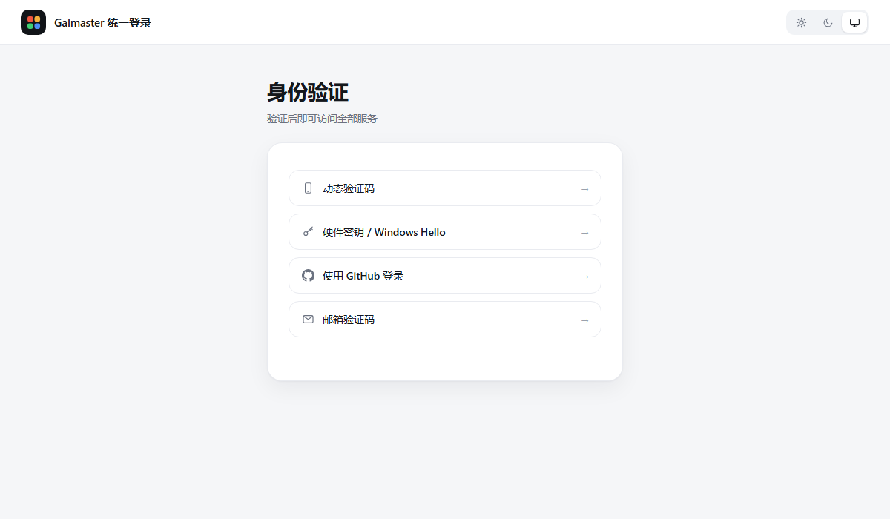

[English](README.md) | **[简体中文](README.zh-CN.md)**

# Galmaster SSO

A self-hosted single sign-on gateway for a personal fleet of web panels,
built on Cloudflare Tunnel. One login covers every service behind it, and
the gateway signs you into each panel's own session as well.

```
                       ┌──────────────────────┐
   browser ──────────► │  auth.example.com    │  login UI
                       │  (this gateway)      │  WebAuthn · TOTP · GitHub · Email
                       └──────────┬───────────┘
                                  │ signed ticket
              ┌───────────────────┼───────────────────┐
              ▼                   ▼                   ▼
        app1.example.com    app2.example.com    monitor.example.com
         (local port)        (local port)        (remote origin)
```

## What it does

- **One session, many hosts.** Sign in once and every `*.example.com` service
  accepts the same cookie. No per-service prompts.
- **Two-factor by design.** A login only completes after **two different**
  methods succeed. Four methods are available: hardware key / Windows Hello,
  TOTP, GitHub (via Cloudflare Access), and email one-time code.
- **Panel auto-login.** Each panel has its own auth mechanism; the gateway
  performs that login on your behalf and hands the resulting cookie, header
  or storage value to the browser. Five different panel types are supported
  out of the box, see `docs/panels.md`.
- **Cross-domain tickets.** When the auth host lives on a different
  registrable domain, a short-lived HMAC-signed ticket carries the session
  across the gap. Tickets are single-use and expire in two minutes.
- **Edge guard.** A ~300 line dependency-free companion (`src/guard.mjs`)
  can sit in front of a service on another machine, sharing only the HMAC key.
  It keeps the round trip local instead of hair-pinning through the gateway.

## Screenshots



See **[docs/screenshots.md](docs/screenshots.md)** for the full tour: the four
sign-in methods, the email one-time code panel, multi-step progress, the
service portal, and the admin page.

## Quick start

```bash
git clone https://github.com/Lbcheng1145/galmaster-sso.git && cd galmaster-sso
cp src/config.example.mjs src/config.mjs && chmod 600 src/config.mjs
npm install && node src/gateway.mjs
```

That gets it running on loopback. Everything else — tunnel ingress, DNS,
Cloudflare Access for GitHub, the Email Worker, systemd units, the edge guard,
a verification checklist and a troubleshooting table — is in the
**[deployment guide](docs/deployment.md)**.

## Requirements

| Piece | Notes |
|---|---|
| Node.js ≥ 18 | `fetch` and `crypto.subtle` are used |
| A domain on Cloudflare | DNS + Tunnel + optional Access |
| `cloudflared` | one tunnel per machine, ingress points at this gateway |
| HTTPS | WebAuthn refuses to run on plain HTTP |

## Documentation

- **[Deployment guide](docs/deployment.md)** — step-by-step from a bare VPS to
  a working gateway: tunnel, DNS, config, systemd, first credential, GitHub,
  email codes, edge guard, verification checklist, troubleshooting
- [Screenshots](docs/screenshots.md) — every screen, with notes on what each
  one does
- [Architecture](docs/architecture.md) — request flow, ticket handoff, trust boundaries
- [Panels](docs/panels.md) — how each panel type is auto-signed-in
- [Security](docs/security.md) — threat model, bypasses that were closed, known limits

## Status

Extracted from a running personal deployment. It is deliberately small and
dependency-light rather than general purpose: there is one owner account,
no user database, and configuration is a single ES module.

## License

MIT
