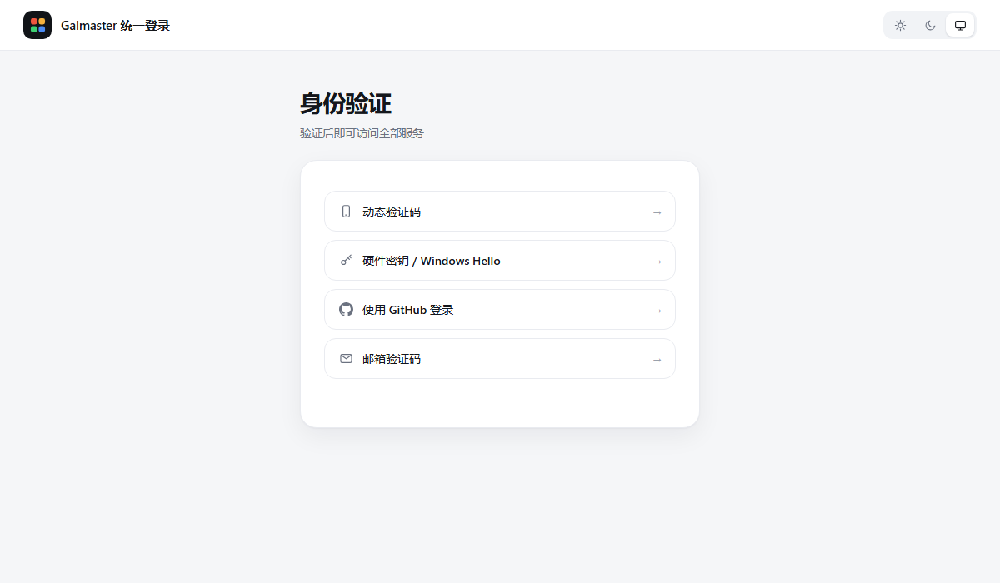
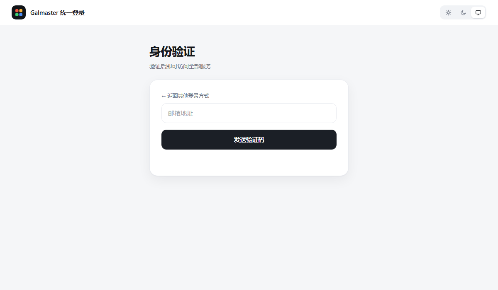
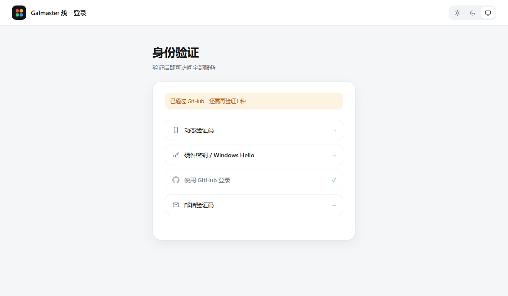
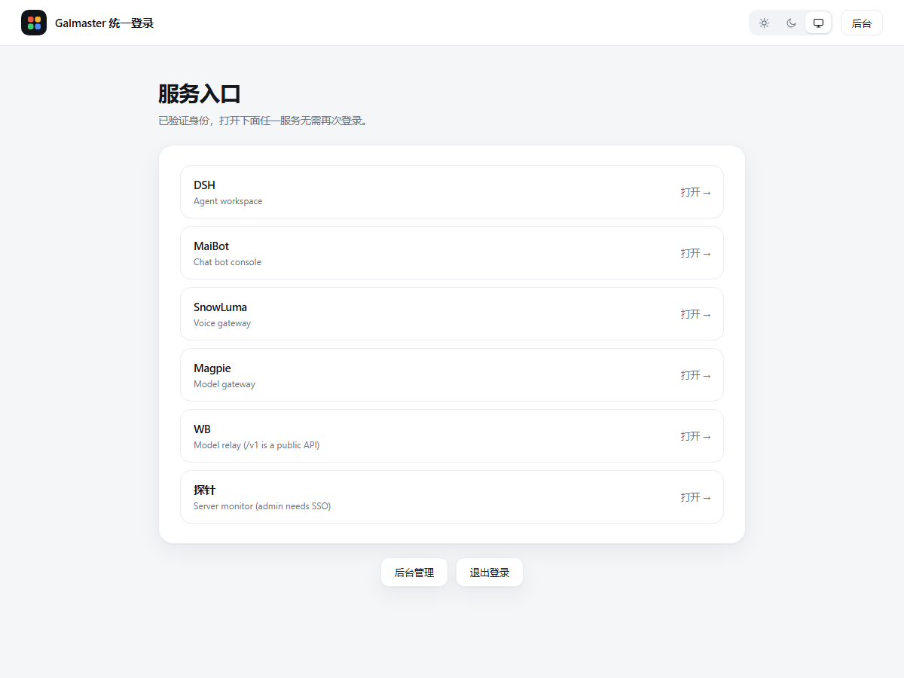
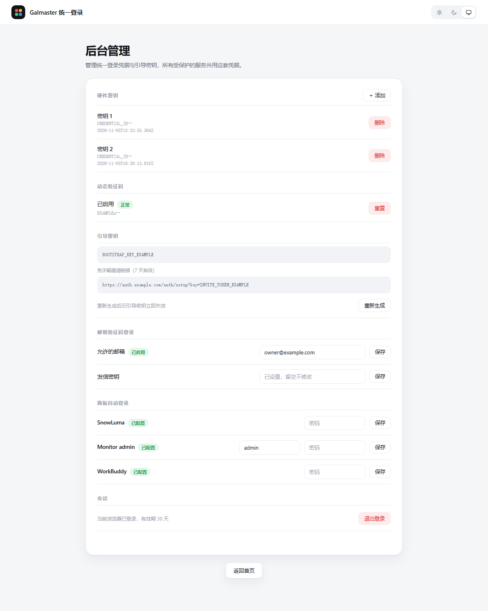

**English** | [简体中文](zh-CN/screenshots.md)

# Screenshots

Every image below is rendered from a running instance with hostnames,
addresses, credential IDs and secrets replaced by placeholders. Nothing here
is a mock-up.

---

## Sign-in

One list, four methods. Pick a row and it folds away, revealing that method's
panel in place. No page navigation, no second tab.

| Method | What the user does |
|---|---|
| 动态验证码 | Types the 6-digit TOTP from their phone |
| 硬件密钥 / Windows Hello | Touches a security key or passes a fingerprint prompt |
| 使用 GitHub 登录 | Redirected through Cloudflare Access to GitHub |
| 邮箱验证码 | Types an email address, receives a 6-digit code |

The list is built from what is actually configured — remove every hardware
key and that row disappears on the next load.

---

## Email one-time code

The code field and the send button share one row. Before sending, the button
fills the row; after sending, the field grows out from the left and the button
shrinks to the right in the same 0.34 s transition. The address field stays
put so you can resend without retyping.

Rate limits: one send per address per 60 s, ten per IP per hour, and five
wrong codes invalidates the challenge.

---

## Multi-step progress

A login completes only after **two different** methods pass. After the first
one, the row turns grey with a green check, then collapses and the remaining
rows close the gap. The banner says which method is already satisfied and how
many are still needed.

The intermediate state is a signed cookie, not a session — it expires in ten
minutes and cannot be replayed as a login.

---

## Service portal

Only rendered once authenticated. The rows are the services from
`config.services`, in config order. Opening any of them needs no further
prompt because they all share one cookie scope.

Signed out, this page does not exist: `/` redirects straight to `/login`.

---

## Admin

| Section | Purpose |
|---|---|
| 硬件密钥 | List, add and delete WebAuthn credentials |
| 动态验证码 | Bind or reset TOTP |
| 引导密钥 | Bootstrap key plus a 7-day invite link, both for first-time setup and recovery |
| 邮箱验证码登录 | Allow-list of addresses, plus the mailer key |
| 面板自动登录 | One row per panel that needs its own credentials |
| 会话 | Sign out — clears every host in the logout chain |

Password fields are always rendered empty; stored panel credentials are never
sent back to the browser.
