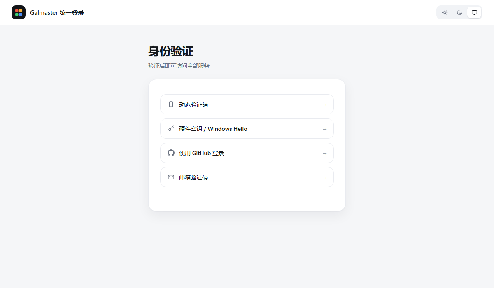
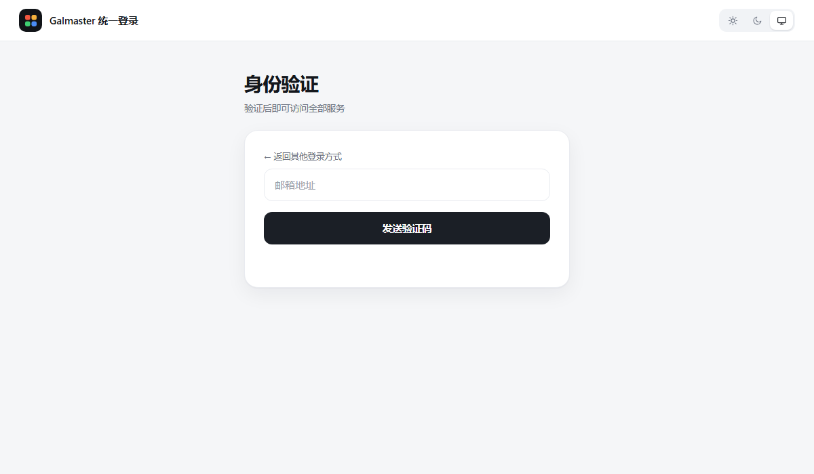
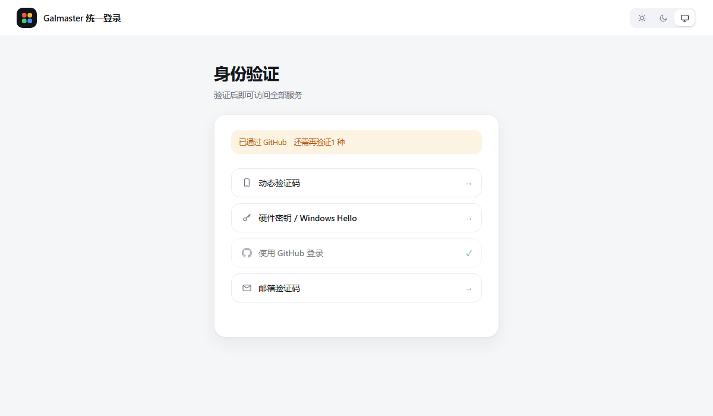
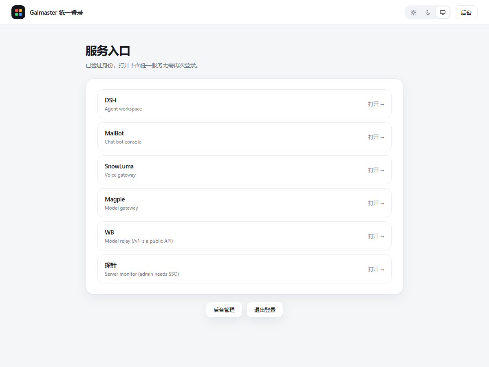
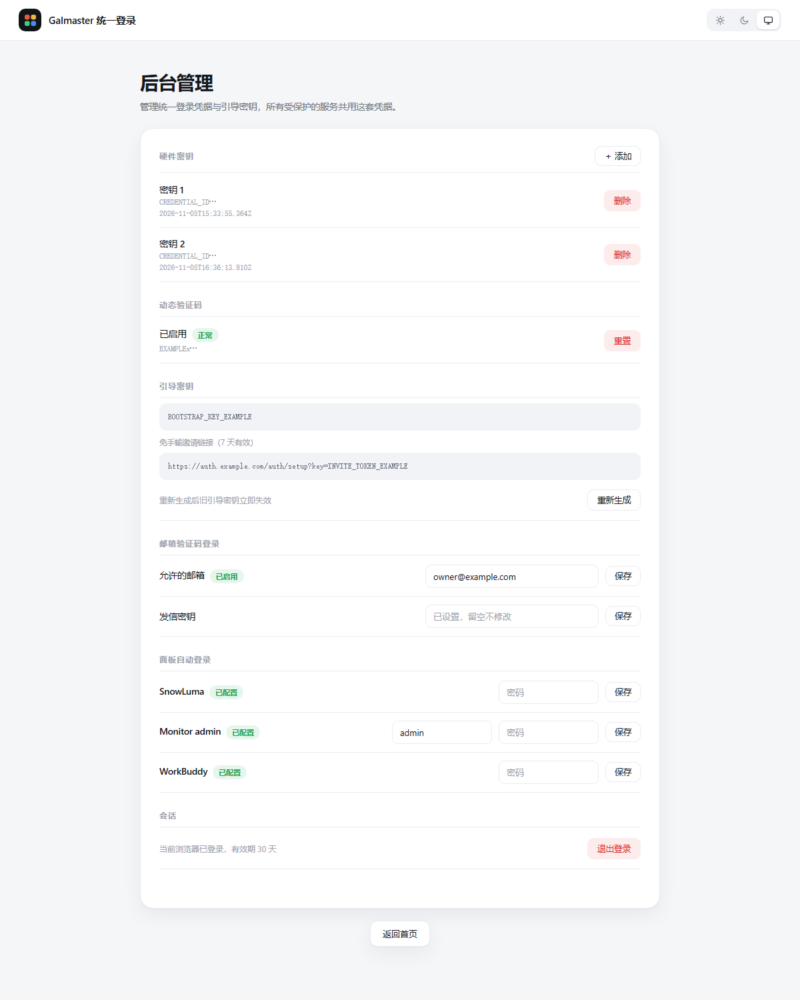

[English](../screenshots.md) | **简体中文**

# 效果图

下面每张图都来自真实运行的实例，只是把域名、地址、凭据 ID 和密钥替换成了
占位符。没有一张是设计稿。

---

## 登录

一个列表，四种方式。点某一行它就会折叠收起，原地展开那一行的面板。不跳页面，
不开新标签。

| 方式 | 用户要做什么 |
|---|---|
| 动态验证码 | 输入手机上的 6 位 TOTP |
| 硬件密钥 / Windows Hello | 触碰安全钥匙，或通过指纹/面容验证 |
| 使用 GitHub 登录 | 经 Cloudflare Access 跳转 GitHub 授权 |
| 邮箱验证码 | 填邮箱地址，收 6 位验证码 |

列表是按实际配置渲染的——把所有硬件密钥删掉，那一行下次加载就不见了。

---

## 邮箱验证码

验证码输入框和发送按钮共用一行。发送前按钮占满整行；发送后输入框从左边长出来，
按钮在同一个 0.34 秒过渡里收缩到右边。邮箱地址那栏原地不动，重发不用重填。

限流：同一地址 60 秒一次，同一 IP 每小时 10 次，输错 5 次即作废。

---

## 多步验证进度

必须**两种不同**方式都通过才算登录成功。通过第一种之后，那一行变灰并打上绿色
对勾，随后折叠消失，剩下的行自动补位。顶部提示条会说明已经通过了哪种、还差
几种。

这个中间态是一张签名 cookie，不是会话——十分钟过期，不能当登录凭证重放。

---

## 服务入口

只有登录后才渲染。列表来自 `config.services`，顺序即配置顺序。点开任何一个
服务都不需要再次验证，因为它们共用一个 cookie 作用域。

未登录时这个页面根本不存在：`/` 直接重定向到 `/login`。

---

## 后台管理

| 区块 | 用途 |
|---|---|
| 硬件密钥 | 列出、添加、删除 WebAuthn 凭据 |
| 动态验证码 | 绑定或重置 TOTP |
| 引导密钥 | bootstrap key 加一条 7 天有效的邀请链接，用于首次配置和恢复 |
| 邮箱验证码登录 | 邮箱白名单，以及发信密钥 |
| 面板自动登录 | 每个需要自己凭据的面板一行 |
| 会话 | 退出登录——会依次清掉退出链上每一个域 |

密码输入框永远是空的，已保存的面板凭据不会回传到浏览器。
